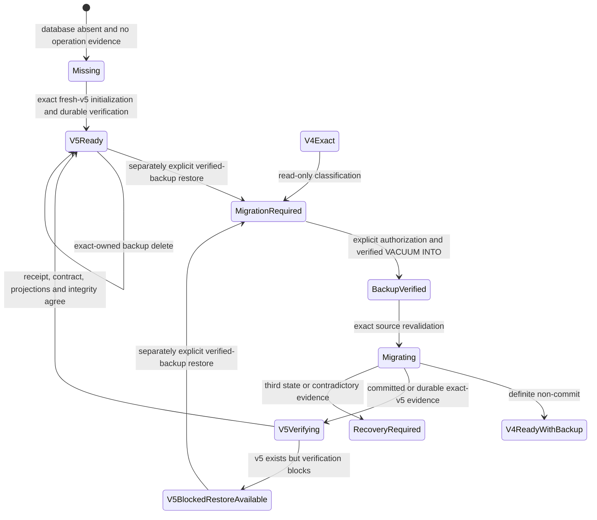

# 17 Desktop Schema-v5 Founder Dogfood Activation Candidate R1

## Reflection projection-order correction — separately authorized 2026/10/31

Runtime reproduction, not merely review inference, is recorded under
`.artifacts/reflection-projection-ordering-r1/run-001/`. Actual coordinator/typed
adapter payloads first create Z,A with equal createdAt, or append Z,A to existing
M with the same key. Both pre-fix requests committed all questions but returned
postcondition mismatch; the reopened order was A,Z or A,M,Z. Red DBs/output and
the old candidates remain immutable. This proves the synthetic trigger, not the
original stopped manual session's historical cause (still UNKNOWN).

### Persisted representation contract

The fixed persisted_artifacts table has TEXT id/created_at with default BINARY
collation. The promoted Reflection writer binds the same prompt.id/created_at
into those columns and payload.id/createdAt; updates retain original creation
keys. Runtime reads now explicitly reject a Reflection column/payload key
contradiction. Array order is canonical projection presentation, not user ranking
or provider-generation order: no ordinal exists in the domain/schema, and no
accepted primary or Book One definition promises a generation-order sequence.
Read SQL orders ascending by created_at, then full id. Time values are compared
as stored text, not parsed instants; differing fractional precision is significant.
Identifier ties use SQLite BINARY, never locale order or JavaScript UTF-16 order.

### Single normalization boundary and refusal rules

Only the typed Rust runtime's Reflection mutation path normalizes expected array
presentation, BEFORE the writer. A bound-input SELECT over json_each orders the
complete supplied Reflection collection using SQLite BINARY on createdAt and id.
It neither queries the post-write actual bundle for expected content nor changes
fields, IDs, timestamps, question/answer text, provenance or other collections.
Frontend/provider/adapters do not duplicate this sorting. No date parsing or
timestamp repair is used; existing writer format/legality rules stay authoritative.

Permutations of one otherwise exact legal Reflection bundle are equivalent.
Unknown fields, duplicate IDs, bad key types/formats, rewritten retained content,
source/provenance contradictions, stale inputs and illegal replacement remain
refused. New suggestions are checked against the promoted writer's exact payload
mapping before mutation, including status, updatedAt=createdAt, model null and
source-array representation. Noncanonical nested representations are refused,
not silently normalized. Skip projection also receives an exact pre-write
content check. The accepted response fix still normalizes ONLY its four optional
user-provider absent/null fields. Native writer, schema, transaction boundaries,
single-action checks and the final full actual != desired postcondition remain
unchanged; no set comparison, retry, split write or false-success catch exists.

The bounded audit covers Reflection suggestion mapping, read keys, skip and
SaveResponse/CorrectResponse representation only. It is not an all-artifact,
legacy-data recovery, dependent-hypothesis lifecycle or cross-process-lock upgrade.
Existing dependent invalidation remains governed by its writer and is not bypassed.
New host/package evidence and Founder acceptance are distinct from the previous
provenance-only and additive-generation candidates. A new candidate may be built
only after focused green, source review and the full canonical verifier pass.

## Reflection additive generation correction R1 — separately authorized 2026/10/31

This follow-up is not covered by the accepted provenance-only seven-file diff
or its `09e0e7c0...` installer. The new candidate is cumulative; its source binding,
verification and Founder review are separate. Original diagnostic receipt and
DBs remain under `.artifacts/reflection-generation-capture-r1/`. They reproduce
a state-dependent contract mismatch, not the historical cause of the stopped
manual session, which remains UNKNOWN.

The explicit first-generation action creates suggested questions. Once questions
exist, the action says **Add another reflection question** and appends the full
generated batch in one existing `CreateSuggestedBatch` mutation, preserving
question IDs, answers, provenance, lineage and UI-only drafts. It never removes
old questions, truncates a batch, retries a failed write, or clears other artifact
collections. Adding a suggestion does not change an answered revision on which
an existing Pattern depends; ordinary source/evidence/answer invalidation rules
are unchanged.

The App uses the shared `reflectionGeneration` coordinator. A source-scoped
synchronous flight guard precedes all awaits. Packets are assembled from durable
source/artifacts, and source, confirmed Evidence, answered Reflection and recovery
snapshots are rechecked before and inside the serialized mutation queue. An exact
local Reflection-set precondition additionally protects suggested changes; it is
checked again at the typed adapter read boundary. This precondition is not provider
context, confirmed evidence, or a new native command/schema/CAS policy. A later
conflicting native write still faces the unchanged canonical single-action and
full-bundle postcondition rules; this slice does not claim cross-process locking.
ID collisions, empty or invalid batches and unconfirmed commits cannot become
success messages. Canonical writers and the prior absent/null provenance fix
remain unchanged. No new ADR is required: ADR-0007/0011 identities, lifecycle,
provenance and deletion decisions are preserved.

Host frontend/mock-IPC, real Rust/SQLite, package and manual UI evidence remain
separate. The new package is not authorized for installation or launch. Do not
touch the stopped profile or transfer its old install/manual authorization.

## Desktop Reflection provenance correction R1 — independent host/build slice

The Founder authorized this follow-up from `7b9e7244ab39bb57f37d3856c366529efc4b25b6`
on 2026/10/28. The historical acceptance/promotion below is not acceptance of
this new diff, package, or complete durable journey.

Before the correction, two new host regressions used captured outputs of the
actual frontend `answerReflectionPrompt` helper through the desktop runtime and
synthetic SQLite. Both first Save and Correct returned
`founder_runtime_projection_postcondition_mismatch` after the canonical write;
verified rereads already contained answer A and B respectively. The actual test
exit was 101. Failed synthetic databases, raw output and the pre-fix test diff
remain under ignored `.artifacts/desktop-reflection-provenance-r1/run-001/`.
The only payload differences were four omitted frontend provenance fields versus
canonical `null`: `provider`, `model`, `harnessVersion`, and `promptVersion`.

The runtime now validates the complete proposed response operation before
invoking SaveResponse or CorrectResponse. Only absent/null representations of
those four fields are normalized. User origin, source/prompt relationships,
operation time, question, prompt provenance, other artifacts and unknown content
remain exact. Non-null contradictions and other mismatches are refused before
mutation. The full post-write comparison remains; no writer, schema, transaction,
retention, retry, Android adapter, UI or Product Harness policy changes.

The runtime is shared by Founder and ordinary desktop compilation; host testing
of both configurations grants no ordinary-profile authority. The captured JSON
fixture is pinned by the frontend typed-adapter test and consumed by the real
Rust SQLite regression. Host connection close/reopen, lineage and parent-delete
checks do not establish application lifecycle or Android/device durability.

The existing candidate build and inspection path remains authoritative. This
slice permits a new suffix package and hash verification only, not installation,
launch, OS-account creation, real/historical-profile access or runtime DB creation.
Fresh canonical/package results and exact bytes are separate run receipts, not
historical PASS transfer. Founder diff and manual acceptance remain separate.

Future manual review requires a new dedicated disposable Windows account/profile,
the unchanged `com.lifeos.founderdogfood` identity and both candidate build gates.
Do not reuse or clear an older candidate/review profile, or substitute `APPDATA`.
Every launch/reopen must explicitly inherit process-scoped `AI_PROVIDER=mock`.
Existing selection directly chooses mock rather than waiting for a provider
failure; its unsupported-provider explanation remains, and remote IPC remains
compiled into the binary. This is not binary-level network prohibition.
See the [Founder package runbook](../dev/09_Windows_Founder_Dogfooding_Package_R1.md).
The original `ANDROID-M2D-036-DIAGNOSTIC-STOP` remains unresolved and untouched.

## Status and authority

This Book One boundary records the **implemented, automated-verified,
Founder-manually accepted, and promoted** Desktop Schema-v5 Founder Dogfood
Activation Candidate R1. Candidate feature commit
`dd6e0be5127e090e9b97b5a1c2788753c5e34115` was promoted by non-fast-forward
merge `44ec6d56d645829488aa73d0b92bcf72b19487f4`. The exact promoted scope was
62 files with 7056 insertions and 353 deletions, measured with
`git diff-tree --no-commit-id --shortstat -r 9a226f7081aabc071571f4a745e1343dbdb7d927 dd6e0be5127e090e9b97b5a1c2788753c5e34115`.

It remains reachable only when both immutable Candidate build gates are true:

- Tauri application identity is exactly `com.lifeos.founderdogfood`;
- the binary is compiled with `founder-schema-v5` and the frontend is compiled
  with `VITE_LIFE_OS_FOUNDER_SCHEMA_V5=1`.

At the time of Candidate promotion, the ordinary `com.lifeos.app` build
retained `SCHEMA_VERSION = 4` and could not select Candidate behavior through
renderer input or a persisted preference. The later ordinary activation R1 is
specified separately by architecture/18 and does not rewrite this Candidate's
isolated identity or historical evidence.

The following states remain distinct:

| State | Current |
| --- | --- |
| Founder-authorized candidate implementation | yes |
| Private/disposable automated evidence | verified |
| Isolated Founder package production path | implemented |
| Founder-manually verified | yes, isolated disposable profiles only |
| Promoted | yes, `44ec6d56` |
| Ordinary desktop production-enabled | no |
| Real-user migrated | no |
| Deployed or released | no |

## Product boundary

The candidate preserves **We Build Mirrors, Not Oracles**. It changes local
database representation and routing, not AI authority, Product Harness output,
historical consent, provider behavior, ContextPacket content, or Phase 4.

It accepts only the Founder package's Tauri-derived app-data root and fixed
`life-os.db` child. No renderer command accepts SQL, a database path, an
activation flag, an operation directory, a backup name, or a schema version.

## State machine

Every restart reconstructs state from the database, fixed path, sidecars, one
exact-owned operation directory, state evidence, backup identity, receipt,
database contract, schema-object manifest, projections, foreign keys, and
integrity. Missing, multiple, malformed, stale, contradictory, or outcome-
unknown evidence fails closed. There is no automatic retry, replay, repair,
rollback, restore, cleanup, or candidate selection.

## Fresh v5 and exact-v4 migration

Fresh initialization builds an empty exact-v4 bootstrap only in an owned,
absent staging pathname, applies the accepted fixed v5 DDL and receipt contract,
enables lifecycle writes, closes and verifies the file, and publishes it only
to an absent Founder database path. No schema-v4 database is exposed as the
live fresh profile.

Migration accepts exact v4 only. It refuses v2, v3, v5 without matching durable
evidence, versions newer than v5, malformed databases, unsafe paths, aliases,
links/reparse points, sidecars, unknown activity, inadequate disk evidence,
permission failures, collisions, or changed source identity. `user_version =
5` remains the last migration mutation.

Opening the app or disclosure is not authorization. Cancel writes nothing.
Authorization creates and verifies exactly one owned `VACUUM INTO` backup before
the DDL transaction.

Founder manual Step 7B exposed one fail-closed Windows path-identity defect:
the durable operation correctly stored the canonical live path, while the
migration request reused the non-canonical Tauri app-data spelling. The request
therefore stopped after `BackupVerified`, before DDL or receipt creation, and
the live schema-v4 database remained byte-identical. Corrective cycle 1 now
passes the operation's exact canonical live identity into the migration core.
Focused tests cover both first authorization from exact v4 and a new explicit
authorization that resumes from an already verified backup. This is not an
automatic retry, repair, replay, or migration authorization.

Founder manual Step 7B-R5 then exposed a second fail-closed coverage gap after
the v5 transaction committed. The fixed synthetic v4 contract fixture and the
promoted schema-v4 runtime create the same eleven legacy SQLite objects, but
SQLite retains the fixture's multiline SQL and the runtime's compact SQL as
different `sqlite_master.sql` bytes. Because the full schema-object manifest
also covers those legacy objects, the fixture-derived exact digest could not
recognize the promoted runtime representation. The live disposable v5 database
retained its two Experiences, four artifacts, receipt, valid foreign keys, and
`integrity_check = ok`; the exact owned v4 backup remained verified and the
operation correctly recorded `V5BlockedRestoreAvailable` without retry.

Corrective cycle 2 preserves the unchanged fixed v5 DDL digest and accepts only
two explicit exact full-schema manifests: the existing contract-fixture form
and the promoted-runtime-v4 form. A third name/body combination still fails
closed. A production-initialized v4 regression now executes the entire owned
backup, migration, and read-only durable verification path. The blocked state
also exposes only a separately confirmed restore of the exact verified v4
backup after operation and backup revalidation; it exposes no retry, repair,
delete, cleanup, or migration-resume control. The captured Founder v5 and v4
files remain untouched until the corrected package is rebuilt and the Founder
chooses the next manual action.

## Runtime routing

After exact-v5 cutover, typed Rust commands verify the activated database
contract before reads or writes. The private runtime routes currently reachable:

- Experience create, exact-revision update, delete, and duplicate-skipping import;
- Evidence candidate batch creation, correction, confirmation, and rejection;
- Reflection suggestion batch, answer, response correction, and skip;
- single-Experience Pattern candidate creation, confirmation, and rejection;
- Context Recovery suggestion, answer, and skip;
- ADR-0009 consent, transmission, Historical Question creation/read/delete,
  exact dependencies, and unsuccessful-audit cleanup.

The accepted private v5 writers remain authoritative. Guarded schema-v4 tables
are compatibility projections. Cross-kind bundle replacement, unsupported
lifecycle actions, stale Experience revisions, stale generation snapshots,
projection drift, and postcondition mismatch fail closed.

## Backup and restore

The exact-owned migration backup has a disclosed 30-day retention deadline and
an explicit delete-now control. Deletion is never claimed unless the owned file,
state, and operation directory are removed as expected. Failure stays visible.

Restore is a separate explicit action. It warns that all disposable local
changes after migration are lost, revalidates ownership and exact backup bytes,
requires quiescence and no sidecars, and uses the conservative Windows
replacement boundary. On Windows that boundary uses same-volume
`MoveFileExW(MOVEFILE_REPLACE_EXISTING | MOVEFILE_WRITE_THROUGH)` after the
closed staging file is flushed and revalidated; it does not claim that Windows
supports a separate parent-directory `FlushFileBuffers` operation. A reported
failure remains outcome-unknown unless exact durable evidence proves otherwise.
Successful restore consumes the migration operation
evidence and reclassifies the database as exact v4. This is not destructive
down migration and cannot undo provider receipt or retention.

## Threat model

| Threat | Boundary |
| --- | --- |
| Ordinary profile selected accidentally | fixed identity plus Cargo/frontend build gates |
| Renderer path or SQL injection | no command accepts path or SQL |
| Time-of-check/time-of-use source change | immediate identity, sidecar, source-manifest and revision revalidation |
| Concurrent database activity | process operation lock plus exclusive SQLite proof; unknown fails closed |
| Ambiguous commit or replacement | exact durable pre/post classification; third state is recovery-required |
| Backup collision or alias | create-new operation ownership and canonical path/link checks |
| Projection as second authority | v5 writer first, guarded v4 projection in one transaction, post-write reconciliation |
| Secret or content leakage in package manifest | six content-free artifact fields only; app data remains ignored |

This candidate does not prove protection against a malicious same-user process,
power-loss durability beyond the documented Windows write-through move and
post-operation evidence, real-user migration safety, or general production
rollout readiness.

## Exact manifest reuse across activation and runtime writes

Founder packaged review proved that a production-initialized schema-v4 source
preserves compact legacy `sqlite_master.sql`, while the contract fixture
preserves equivalent multiline SQL. Migration, restart verification, and every
typed runtime writer therefore share one predicate that accepts exactly those
two fixed full-schema manifest digests and no third representation. The fixed
schema-v5 DDL digest and contract-fixture digest remain unchanged.

The first cycle-2 packaged runtime Experience create correctly failed before
`BEGIN IMMEDIATE` because the Experience verifier had not yet reused that
shared predicate. Corrective cycle 3 removes the duplicate single-digest check
and adds a production-initialized-v4 migration followed by a typed Experience
write and read-only reconciliation. This correction changes no schema object,
DDL, projection rule, provider, consent, or ordinary-profile behavior.

## Context Recovery runtime follow-up

The bounded Candidate R1 sprint was archived truthfully as incomplete after
using all three permitted correction cycles. During the remaining Founder
manual journey, Evidence creation/correction/confirmation and Reflection
creation/answer/correction passed on the disposable fresh-v5 profile. Context
Recovery suggestion also passed, but saving the first response appeared inert.

After normal application close, read-only evidence showed one unchanged
suggested/pending `recovery_turn`, no partial response revision, no SQLite
sidecars, valid foreign keys, and integrity `ok`. Source inspection identified
an exact facade defect: the runtime requested artifact kind
`context_recovery`, while the accepted writer, normalized head, and guarded-v4
projection all use `recovery_turn`.

Founder Decision
`FOUNDER-SCHEMA-V5-CANDIDATE-R1-CONTEXT-RECOVERY-FOLLOWUP-004` authorizes one
separate minimal correction. The runtime now queries `recovery_turn`. It also
validates the user response provenance supplied by the product boundary and
canonicalizes only its absent optional user-provider fields to the exact null
representation already emitted by the promoted writer before strict
postcondition comparison. Contradictory provenance fails before the writer and
leaves the suggestion unchanged. A real-facade disposable regression covers
suggestion followed by first answer and exact durable reconciliation.

The visible Context Recovery region now carries a session-only localized alert
when its explicit Save or Skip mutation fails. The existing general diagnostic
error remains available. No automatic retry, optimistic durable claim, schema
change, new action, historical eligibility, provider behavior, or profile
mutation was added.

The corrected unsigned review package was built without installing or launching
it. Its content-free manifest records application version `0.2.0`, repository
HEAD `9a226f7081aabc071571f4a745e1343dbdb7d927`, target
`x86_64-pc-windows-msvc`, size `5681429` bytes, and SHA-256
`1585ae219ee041d36dcca9827117ea1226c8444f96d422297ebfd81f1007a285`.
The package remains isolated Founder-only evidence; creation does not authorize
installation, profile mutation, distribution, deployment, or release.

## Verification and Founder gate

Automated evidence used synthetic/disposable fixtures. Founder manual evidence
used only the isolated Founder profile and unsigned Candidate package. That
evidence and promotion do not make the Candidate ordinary-profile enabled,
real-user verified, distributed, deployed, or released.

Android Build Feasibility M0 remains parked behind the desktop sequencing gates
recorded by the Founder. This document grants no Android authority.
